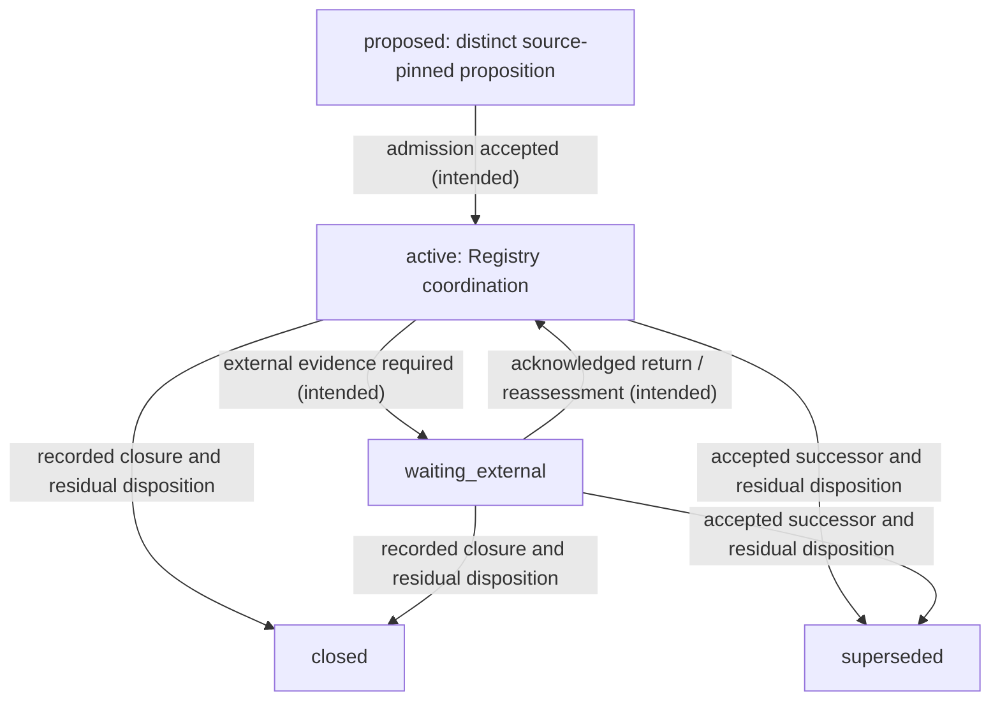
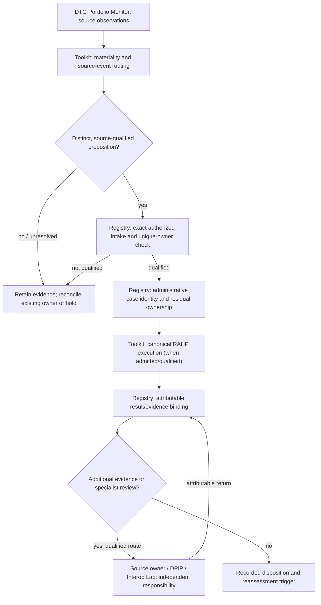

# Assessment case identity and lifecycle

## Admission

One case describes a materially distinct assurance proposition for a defined subject and source context. If a new observation affects the same proposition, append source provenance and assess applicability before opening another case. A change marker is not a defect.

A case must include stable `case_id`, `subject`, `proposition`, `source`, `owners`, `lifecycle`, `evidence`, `assessment`, `residuals` and `reassessment` fields. The current validator checks structural and key cross-field invariants, including immutable 40-character Git commit source revisions, returned referral revision syntax, producer issue-URL/repository alignment, and equality between an imported result's claimed source revision and the case revision. It does **not** establish that a commit exists, that the GitHub author is authoritative, or that the returned/imported result is authentic; those require evidence from the authoritative producer/controller. It is not a normative RAHP schema or a substitute for a human assessment.

## Separate dimensions

- **Administrative lifecycle:** `proposed`, `active`, `waiting_external`, `superseded`, `closed`. These describe ownership and coordination.
- **Evidence state:** `unverified`, `partially_verified`, `verified`, `unavailable`, `contradictory`. These describe attributable availability/adequacy, not truth of every claim.
- **Assessment determination:** `not_assessed`, `PASS`, `FAIL`, `NOT_APPLICABLE`, `INDETERMINATE`. Except `not_assessed`, these are RAHP determinations **imported from an attributable RAHP result** with a recorded assessment identity, source revision, matching determination and result URI; registry administration never invents one. An analytical source-level classification is not an RAHP determination. A structurally plausible URI is not independently verified as authentic by the validator.
- **Source-level change classification:** `new`, `preserved`, `strengthened`, `weakened`, `uncertain`. This is analytical classification, not conformance.

A case with unresolved residuals can be *administratively* closed only when every residual has a durable, explicitly accepted receiving owner and the closeout says that outstanding assurance has not passed. `closed` does not set `PASS`.

## Administrative states and transition controls

The following diagram is a **descriptive operating model**, not an implemented
transition engine. The case validator currently checks that the stored state
belongs to the administrative enum and that terminal states satisfy residual
and ownership restrictions. It does **not** inspect a sequence of state
changes, prevent arbitrary nonterminal rewrites, authorize reopening, or
independently authenticate a receiving owner.

| Transition or invariant | Current enforcement | Additional operational evidence / limitation |
| --- | --- | --- |
| Any recorded administrative state | **Enforced structurally:** one of `proposed`, `active`, `waiting_external`, `superseded`, `closed` | Git history does not constitute an enforced transition history. |
| `proposed` → `active` | **Not a generic validator transition check** | Distinct source-qualified proposition, protected admission authorization and unique Registry issue-owner check are required by the applicable intake route. |
| `active` → `waiting_external` | **Not a validator transition check** | Record a real evidence dependency or qualified referral; a requested referral alone is not an external determination. |
| `waiting_external` → `active` | **Not a validator transition check** | Verify source-attributable return and reassessment scope before recording an administrative change. |
| `active` / `waiting_external` → `closed` or `superseded` | **Enforced structurally on target state:** every residual has `status: transferred` and an owner; `handoff: not_accepted` cannot be terminal | An actual accepted receiving owner and truthful closeout remain external governance evidence, not established by plausible JSON alone. |
| Reopen a terminal case or create a new assessment epoch | **Not defined as a generic enforced transition** | Decide whether the same proposition remains applicable or a distinct case is warranted; retain earlier outcome, revision, issue identity and reassessment trigger. Do not infer a new case from a source fingerprint. |
| Evidence state or imported RAHP determination changes | **Separate validation dimension**, not an administrative transition | A non-`not_assessed` determination needs a matching imported result; `PASS` also requires verified evidence and attributable basis. Structural validation does not authenticate the producing run. |

In particular, `closed` and `superseded` never imply `PASS`.
No additional administrative state or automatic reopen transition is introduced
by this documentation.

## Cross-repository case and evidence flow

This diagram distinguishes the **implemented publication-owner boundary** from
the **end-to-end acceptance still pending** in
[Registry #77](https://github.com/sankarshanmukhopadhyay/rahp-assessment-registry/issues/77).
It is a responsibility and intended-execution flow, not a claim that an
unattended first-new-case route has already completed.

The Monitor is an evidence observatory, Toolkit owns the RAHP method and
execution, and Registry owns **external case admission and administration**.
Their source commits, case IDs, GitHub issue numbers, RAHP assessment IDs,
and specialist referral identifiers are distinct namespaces. A successful
observation, validated intake, issue closure, or specialist acknowledgment is
not a conformance or assurance determination.

A historical Toolkit-to-Registry handoff transfers only accepted administrative
coordination, not the original issue contents or canonical Toolkit execution
identity. See the [historical reference index](../archive/issue-index.md),
[accepted succession index](../archive/succession-index.md) and
[case succession rules](case-succession.md).

## Receipt and handoff

1. Observe consolidated source finding and compare existing case identities.
2. Identify proposition, authoritative source revision, applicable protocol/release and consuming context.
3. Confirm distinct registry owner versus source-system, RAHP implementation and specialist owners.
4. Assess evidence against the target's positive, negative and false-success paths.
5. Record dated disposition, residual dependencies and retest trigger.
6. Transfer only with an acknowledged owner and original issue reference.
7. Recheck that an old source issue is not falsely represented as resolved before closing it.

Case records are version-controlled snapshots. Use precise source pointers and retain the original issue history; do not bulk copy comment trails into JSON.

## Historical initial pilot acceptance (November 2026)

- Validate one real source-pinned case with both positive and negative structural checks.
- Verify a newcomer can trace the finding, upstream change and remaining case owner.
- Demonstrate that missing evidence cannot become assurance PASS or administrative terminalization.
- Leave the original Toolkit issue active until a separate handoff is explicitly accepted.
- Do not activate automation or bulk transfers before evaluating the pilot.

## Pilot owner handoff boundary (2026-11-16)

Case `RAHP-AR-DTG-0001` has [registry issue #4](https://github.com/sankarshanmukhopadhyay/rahp-assessment-registry/issues/4) as its durable **external evidence coordination owner**. The previous [RAHP Toolkit #1203](https://github.com/sankarshanmukhopadhyay/rahp-toolkit/issues/1203) remains a cited historical source, not a required controller execution ID: no DPIP or Lab return was initiated against #1203. A future specialist or producer request must originate from the compatible RAHP controller through its existing supported route; registry issue #4 cannot receive or reconcile RAHP results by itself. Keep `not_assessed` until a genuine RAHP result is imported. Do not extrapolate this manual pilot handoff to issue-driven controller records.

**Current authority (23 November 2026):** the protected Toolkit policy now
sets external-case publication `owner: registry`; the four old external writer
registrations were retired and Registry's guarded receiving path validated.
That is a publication-authority switch, **not** a claim that all G1–G6
new-case execution and specialist-return gates have passed. The historical
pilot restrictions above describe the earlier admission context and should
not be used to re-enable Toolkit issue writers.
